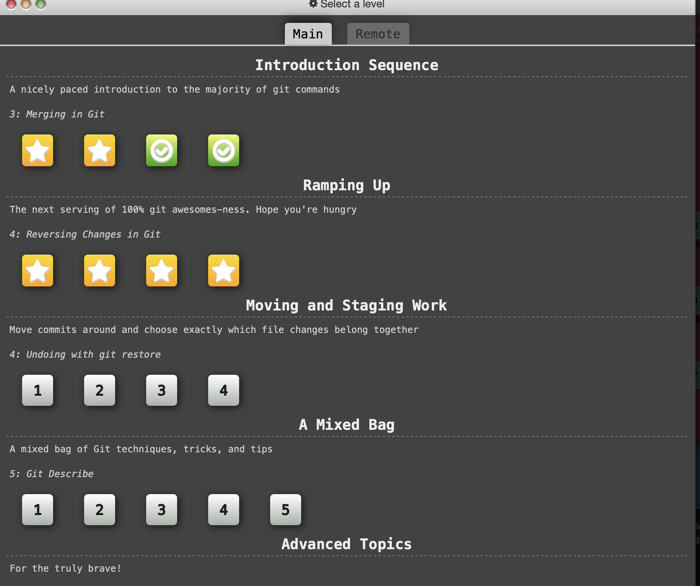
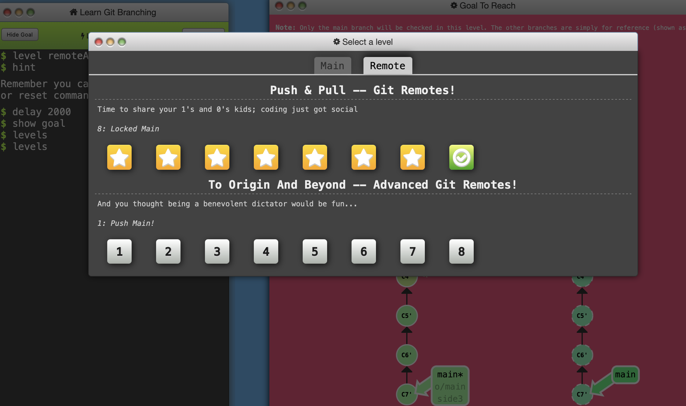

# HW2: Learn Git Branching

## Process

I completed the Introduction, Ramping Up, and Push & Pull -- Git Remotes!
sequences in Learn Git Branching. I read the tutorials, entered commands
in the game, and compared the resulting commit graphs with the goals.

I practiced creating and switching branches, merging, rebasing, using
detached HEAD and relative references, and undoing changes with reset
and revert. The remote levels covered cloning, fetching, pulling, and
pushing, including integrating remote changes before publishing my work.

## AI Assistance

I used Codex to explain concepts, interpret level instructions. When I was stuck, I used it to provide step-by-step explanation.

## Completion Screenshots

### Introduction and Ramping Up

### Push & Pull -- Git Remotes!

